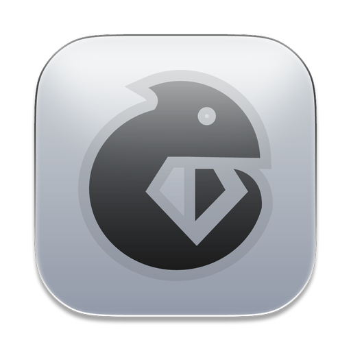
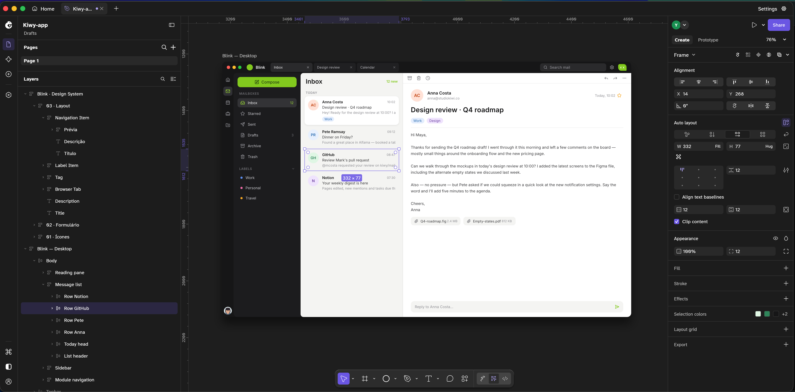

<div align="center">
  
  <h1>Lizard</h1>
  <p>A native interface design editor built with Rust and egui.</p>
</div>

Lizard has a vector canvas, auto layout, components, styles, prototyping, plugins, and an agent panel that works with the open document. It is an independent continuation of earlier open-source work. The original contributors retain their credits and copyrights; see [contributors](contributors/contributors.json), [NOTICE](NOTICE), [LICENSE-MIT](LICENSE-MIT), and [LICENSE-APACHE](LICENSE-APACHE).



## Download

Get the latest published installer from [GitHub Releases](https://github.com/brava-group/lizard/releases). macOS releases include a universal `Lizard.app` for Apple silicon and Intel Macs. Drag the app into Applications.

Packaged macOS builds check for newer stable releases on startup and periodically afterward. When an update is available, Lizard offers to download and verify it, then restarts to install it after open documents are saved. Updates require a Developer ID signed and notarized release; the app verifies the GitHub asset digest, signature, team, bundle identity, version, and Gatekeeper approval before installation.

New native documents use `.lzd`. Legacy `.lizard` and `.figcraft` files still open.

## Build from source

Install a current Rust toolchain, then run from the repository root:

```sh
cargo run -p lizard --bin lizard
```

On macOS, launch the local app bundle to show **Lizard** in the Dock:

```sh
packaging/macos/dev-app.sh
```

To let the in-app agent find and place Unsplash photos, configure an Unsplash API Access Key in the app's local environment before launch. The agent uses `search_stock_photos` and `place_stock_photo`; photo credits and source links are kept on the image layer. The key is never written to a design document or chat history.

```sh
LIZARD_UNSPLASH_ACCESS_KEY=your_access_key cargo run -p lizard --bin lizard
```

The CLI and browser build are available through the workspace:

```sh
cargo run -p lizard-cli -- --help
cargo xtask wasm
```

## Privacy and online sharing

Lizard has **no default online collaboration server**. Local editing and local network sharing work without one. To publish a document online, configure a server you operate or trust under **Preferences → Server for online sharing**, or use **File → Publish to server** with that server's address. Builds can optionally embed an organization-specific default with `LIZARD_DEFAULT_SERVER=wss://your-host/`.

The collaboration server source is included in [`apps/lizard-server`](apps/lizard-server). Its executable is `lizard-server`. It stores shared files, manages edit and view links, and serves live sessions. Each server operator controls their own storage, access, retention, and terms.

## Self-host on a VPS

A Linux VPS with a DNS name, Rust, and a TLS reverse proxy is sufficient. The commands below assume Debian or Ubuntu. Replace `design.example.com` with your DNS name.

```sh
sudo apt update
sudo apt install -y build-essential git curl caddy
curl --proto '=https' --tlsv1.2 -sSf https://sh.rustup.rs | sh -s -- -y
. "$HOME/.cargo/env"
git clone https://github.com/brava-group/lizard.git
cd lizard
cargo build --release --locked -p lizard-server
sudo install -m 755 target/release/lizard-server /usr/local/bin/lizard-server
sudo useradd --system --home-dir /var/lib/lizard-server --shell /usr/sbin/nologin lizard
sudo install -d -o lizard -g lizard -m 700 /var/lib/lizard-server
sudo install -d -m 755 /etc/lizard-server
```

Create `/etc/lizard-server/server.toml` with a loopback listener and your public TLS address:

```sh
sudo tee /etc/lizard-server/server.toml >/dev/null <<'EOF'
listen = "127.0.0.1:47900"
data = "/var/lib/lizard-server"
public_url = "wss://design.example.com/"
trusted_proxy = "127.0.0.1"
EOF
```

Install the included [systemd unit](packaging/server/lizard-server.service) and set Caddy to proxy your hostname to `127.0.0.1:47900`. The included [Caddyfile](packaging/server/Caddyfile) is a starting point:

```sh
sudo cp packaging/server/lizard-server.service /etc/systemd/system/
sudo systemctl daemon-reload
sudo systemctl enable --now lizard-server
sudo cp packaging/server/Caddyfile /etc/caddy/Caddyfile
# Edit /etc/caddy/Caddyfile to use your DNS name.
sudo systemctl reload caddy
curl https://design.example.com/healthz
sudo -u lizard lizard-server --config /etc/lizard-server/server.toml key
```

The final command prints the address and server key for publishing. Keep the key private. Only expose ports 80 and 443; keep port 47900 on loopback. Keep `/var/lib/lizard-server` backed up.

## Development

- [Roadmap](ROADMAP.md)
- [Contributor instructions](AGENTS.md)

Run `cargo xtask ci` before committing when resources permit. The editor targets macOS, Windows, Linux, FreeBSD, and WebAssembly.

## License

MIT OR Apache-2.0. See [NOTICE](NOTICE) for contributor and asset notices.
