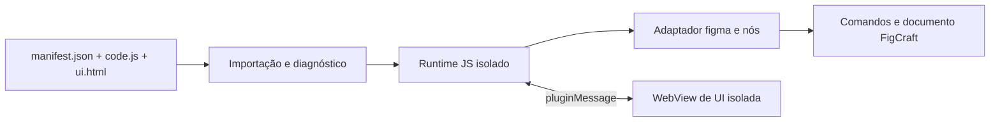

# Compatibilidade com plugins do Figma

Investigação de 18/10/2026. Este documento define um caminho para executar plugins JavaScript fornecidos pelo usuário no FigCraft. Ele não declara que plugins do Figma já possam ser instalados ou executados.

## Evidência e limites

- **Documentação pública:** um plugin declara `manifest.json`, com `main` JavaScript, `ui` HTML opcional, tipo de editor, versão da API, acesso ao documento e domínios de rede. O código principal roda num sandbox JavaScript com acesso à árvore do documento; a UI roda num iframe com APIs de navegador. Os dois lados trocam mensagens. Páginas podem ser carregadas sob demanda. Fontes: [manifesto](https://developers.figma.com/docs/plugins/manifest/), [execução](https://developers.figma.com/docs/plugins/how-plugins-run/), [UI](https://developers.figma.com/docs/plugins/creating-ui/) e [acesso ao documento](https://developers.figma.com/docs/plugins/accessing-document/).
- **Pacote desktop local:** a inspeção estática com REA de uma cópia temporária dos JavaScript extraídos de `/Applications/Figma.app/Contents/Resources/app.asar` encontrou uma aplicação Electron, IPC entre processos e, em `main.js`, um registro de extensões locais que lê `manifest.json` e observa alterações em manifesto, código e UI. Evidência REA `ev_c0f4a31624acffe79b3456eaaed058f4c8774909bd68291ed8dc1fb28066a9bd` (resumo `ev_d4af4ea81d4e20fdca221cb672fbac976ccc775ae5945c50cbbdc60107f808a7`). A análise é estática e parcial; ela não prova o comportamento em execução nem documenta o serviço da Community. Nenhum código ou recurso extraído entra no FigCraft.
- **FigCraft hoje:** `crates/plugin` executa módulos WebAssembly em `wasmi`; `crates/engine/src/plugins.rs` expõe comandos do editor com limites, permissões e rollback; `crates/ui-egui/src/plugins_ui.rs` desenha painéis nativos. O manifesto próprio é `figcraft-plugin.json` com `main` `.wasm`. Portanto, trocar apenas o nome do manifesto ou converter JSON não executa um plugin do Figma.

## Arquitetura proposta

1. **Importação local primeiro.** Aceitar uma pasta com `manifest.json` e os arquivos indicados, validar caminhos relativos sem escapar da pasta, limites de tamanho, versão da API, `editorType` e domínios de rede. Mostrar nome, origem, hash, domínios declarados e um relatório preliminar de APIs ainda não suportadas. Esse relatório não prova todas as chamadas que o plugin fará em execução. Persistir a origem e verificar novamente o hash ao iniciar. Manter esse formato separado do manifesto WASM atual.
2. **Runtime JavaScript separado.** Executar `main` em um motor que suporte o JavaScript exigido pelo contrato público, com limite de tempo/instruções, memória e chamadas ao host. Expor `figma` e globais documentados (`__html__`, `__uiFiles__`) por uma camada própria. A instalação só passa a ser marcada como “executável” depois de um teste real do runtime. O projeto ainda não contém esse motor.
3. **Árvore de nós como objetos vivos.** Proxies de nós precisam manter identidade, filhos, seleção e mudanças de propriedades. Operações de leitura usam o documento; mutações passam pela camada de comandos do engine e formam uma unidade de undo por execução ou evento. IDs, cores, paints, fontes, componentes e variáveis exigem adaptadores específicos; uma simples tradução de chamadas para nomes de comandos perde a semântica de propriedades e objetos.
4. **UI HTML isolada.** `figma.showUI()` abre uma WebView com o HTML do plugin. `figma.ui.postMessage` e `parent.postMessage({pluginMessage: ...})` atravessam uma ponte com validação de origem, limite de tamanho e encerramento de sessão. A UI não recebe acesso direto ao documento. Em plataformas sem WebView segura, plugins com `ui` aparecem como incompatíveis até existir essa capacidade.
5. **Rede e dados persistentes.** Aplicar `networkAccess.allowedDomains` também ao código principal e à UI, negar acesso por padrão quando solicitado pelo manifesto e separar `clientStorage` por plugin. Pedidos de rede, clipboard, arquivos, câmera e OAuth precisam de permissões e políticas explícitas; nenhum deles deve herdar acesso irrestrito do processo do FigCraft.
6. **Distribuição.** A primeira entrada deve ser uma pasta local fornecida pelo usuário ou um pacote distribuído pelo autor. A documentação pública do manifesto não oferece, por si só, uma API de instalação de plugins publicados na Community; não projetar um botão “Instalar da Community” até existir uma fonte de pacotes autorizada e verificável.

## Recorte de compatibilidade

| Etapa | Capacidade | Critério de aceitação |
|---|---|---|
| 0 | Importar e diagnosticar um plugin local | Manifesto, caminhos, versão e dependências analisados; nenhuma promessa de execução |
| 1 | Plugin sem UI: seleção, leitura, criação e propriedades básicas de nós | Plugins de teste escritos contra a API pública rodam sem alteração e com undo/rollback |
| 2 | UI HTML, mensagens e armazenamento | Fluxo de botão na UI altera o documento e reabre com estado persistente |
| 3 | Imagens, fontes, componentes, estilos, variáveis e páginas dinâmicas | Matriz de APIs e corpus de plugins reais com resultados registrados |
| 4 | Rede, Dev Mode, widgets e recursos especiais | Permissões e testes por plataforma; incompatibilidades ficam visíveis ao usuário |

**Decisão de produto:** começar pela etapa 0 e por um pequeno conjunto de plugins locais sem UI. Medir compatibilidade por plugin e por API, nunca anunciar compatibilidade geral antes das etapas 2–4. O runtime WASM nativo do FigCraft continua útil como formato próprio; a ponte JavaScript é outro backend de execução.

## Testes necessários ao iniciar a implementação

- Plugins sintéticos com leitura, escrita, erro após escrita e loop infinito; verificar limites e rollback.
- Manifests com caminhos absolutos, `../`, symlinks, arquivos ausentes e versões incompatíveis.
- Mensagens de UI grandes ou malformadas, tentativa de acessar o documento pela WebView e rede fora da allowlist.
- Mesmos plugins em macOS, Windows, Linux e navegador; registrar diferenças antes de marcar qualquer plugin como compatível.
