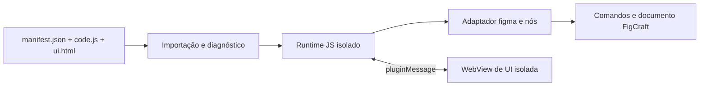

# Compatibilidade com plugins do Figma

Investigação de 18/10/2026. Este documento define um caminho para executar plugins JavaScript fornecidos pelo usuário no FigCraft. Ele não declara que plugins do Figma já possam ser instalados ou executados.

## Evidência e limites

- **Documentação pública:** um plugin declara `manifest.json`, com `main` JavaScript, `ui` HTML opcional, tipo de editor, versão da API, acesso ao documento e domínios de rede. O código principal roda num sandbox JavaScript com acesso à árvore do documento; a UI roda num iframe com APIs de navegador. Os dois lados trocam mensagens. Páginas podem ser carregadas sob demanda. Fontes: [manifesto](https://developers.figma.com/docs/plugins/manifest/), [execução](https://developers.figma.com/docs/plugins/how-plugins-run/), [UI](https://developers.figma.com/docs/plugins/creating-ui/) e [acesso ao documento](https://developers.figma.com/docs/plugins/accessing-document/).
- **Pacote desktop local:** a inspeção estática com REA de uma cópia temporária dos JavaScript extraídos de `/Applications/Figma.app/Contents/Resources/app.asar` encontrou uma aplicação Electron, IPC entre processos e, em `main.js`, um registro de extensões locais que lê `manifest.json` e observa alterações em manifesto, código e UI. Evidência REA `ev_c0f4a31624acffe79b3456eaaed058f4c8774909bd68291ed8dc1fb28066a9bd` (resumo `ev_d4af4ea81d4e20fdca221cb672fbac976ccc775ae5945c50cbbdc60107f808a7`). A análise é estática e parcial; ela não prova o comportamento em execução nem documenta o serviço da Community. Nenhum código ou recurso extraído entra no FigCraft.
- **FigCraft hoje:** `crates/plugin` executa módulos WebAssembly em `wasmi`; `crates/engine/src/plugins.rs` expõe comandos do editor com limites, permissões e rollback; `crates/ui-egui/src/plugins_ui.rs` desenha painéis nativos. O manifesto próprio é `figcraft-plugin.json` com `main` `.wasm`. Portanto, trocar apenas o nome do manifesto ou converter JSON não executa um plugin do Figma.

## Arquitetura proposta

1. **Importação local primeiro.** Aceitar uma pasta com `manifest.json` e os arquivos indicados, validar caminhos relativos sem escapar da pasta, limites de tamanho, versão da API, `editorType` e domínios de rede. Mostrar nome, origem, hash, domínios declarados e um relatório preliminar de APIs ainda não suportadas. Esse relatório não prova todas as chamadas que o plugin fará em execução. Persistir a origem e verificar novamente o hash ao iniciar. Manter esse formato separado do manifesto WASM atual.
2. **Runtime JavaScript separado.** Executar `main` em um motor que suporte o JavaScript exigido pelo contrato público, com limite de tempo/instruções, memória e chamadas ao host. Expor `figma` e globais documentados (`__html__`, `__uiFiles__`) por uma camada própria. A instalação só passa a ser marcada como “executável” depois de um teste real do runtime. O projeto ainda não contém esse motor.
3. **Árvore de nós como objetos vivos.** Proxies de nós precisam manter identidade, filhos, seleção e mudanças de propriedades. Operações de leitura usam o documento; mutações passam pela camada de comandos do engine e formam uma unidade de undo por execução ou evento. IDs, cores, paints, fontes, componentes e variáveis exigem adaptadores específicos; uma simples tradução de chamadas para nomes de comandos perde a semântica de propriedades e objetos.
4. **UI HTML isolada.** `figma.showUI()` abre uma WebView com o HTML do plugin. `figma.ui.postMessage` e `parent.postMessage({pluginMessage: ...})` atravessam uma ponte com validação de origem, limite de tamanho e encerramento de sessão. A UI não recebe acesso direto ao documento. Em plataformas sem WebView segura, plugins com `ui` aparecem como incompatíveis até existir essa capacidade.
5. **Rede e dados persistentes.** Aplicar `networkAccess.allowedDomains` também ao código principal e à UI, negar acesso por padrão quando solicitado pelo manifesto e separar `clientStorage` por plugin. Pedidos de rede, clipboard, arquivos, câmera e OAuth precisam de permissões e políticas explícitas; nenhum deles deve herdar acesso irrestrito do processo do FigCraft.
6. **Distribuição.** A primeira entrada deve ser uma pasta local fornecida pelo usuário ou um pacote distribuído pelo autor. A documentação pública do manifesto não oferece, por si só, uma API de instalação de plugins publicados na Community; não projetar um botão “Instalar da Community” até existir uma fonte de pacotes autorizada e verificável.

## Recorte de compatibilidade

| Etapa | Capacidade | Critério de aceitação |
|---|---|---|
| 0 | Importar e diagnosticar um plugin local | Manifesto, caminhos, versão e dependências analisados; nenhuma promessa de execução |
| 1 | Plugin sem UI: seleção, leitura, criação e propriedades básicas de nós | Plugins de teste escritos contra a API pública rodam sem alteração e com undo/rollback |
| 2 | UI HTML, mensagens e armazenamento | Fluxo de botão na UI altera o documento e reabre com estado persistente |
| 3 | Imagens, fontes, componentes, estilos, variáveis e páginas dinâmicas | Matriz de APIs e corpus de plugins reais com resultados registrados |
| 4 | Rede, Dev Mode, widgets e recursos especiais | Permissões e testes por plataforma; incompatibilidades ficam visíveis ao usuário |

**Decisão de produto:** começar pela etapa 0 e por um pequeno conjunto de plugins locais sem UI. Medir compatibilidade por plugin e por API, nunca anunciar compatibilidade geral antes das etapas 2–4. O runtime WASM nativo do FigCraft continua útil como formato próprio; a ponte JavaScript é outro backend de execução.

## Testes necessários ao iniciar a implementação

- Plugins sintéticos com leitura, escrita, erro após escrita e loop infinito; verificar limites e rollback.
- Manifests com caminhos absolutos, `../`, symlinks, arquivos ausentes e versões incompatíveis.
- Mensagens de UI grandes ou malformadas, tentativa de acessar o documento pela WebView e rede fora da allowlist.
- Mesmos plugins em macOS, Windows, Linux e navegador; registrar diferenças antes de marcar qualquer plugin como compatível.

## Segunda passagem pelos binários

Alvo: Figma Desktop `126.9.13` em macOS. O ASAR instalado tem um registro de extensão local em `main.js`; para a análise do REA, foi extraído um recorte de 13.138 bytes correspondente aos offsets **820251–833388** do arquivo (`main.js` SHA-256 `5ff5373b176c282f7389aa437a0d553bcd3dbf9ff5846dfac1f3641cdee40371`). A análise isolada está em `ev_c462da93362aa9e0eb8bddb3898968119d5f2d830a3626bafe46bfa09a9ed1ff`, resumo `ev_566730b72174234f83a2a4cdc40a5ada608b4d6a3883371b6219961501d3de3b`. Os offsets permitem localizar o mesmo trecho no artefato instalado; o recorte e o código não fazem parte deste repositório.

| Observação estática | Consequência para o FigCraft |
|---|---|
| O registro aceita um arquivo chamado `manifest.json`, guarda caminhos e metadados, e distingue arquivos de manifesto, código e UI. | Guardar instalação e diagnóstico separadamente da execução. Um plugin pode estar instalado e não ser compatível. |
| O registro observa alterações nesses arquivos e comunica mudanças aos interessados. | Hot reload cabe no modo Desenvolvimento; reinstalação precisa descartar a sessão JS anterior e revalidar o manifesto. |
| A leitura local aceita `main` (e uma forma legada `script`), `ui` como string ou mapa, e uma forma legada `html`. | Suportar primeiro as formas documentadas `main` e `ui`; rejeitar as legadas com diagnóstico claro até haver teste próprio. |
| Na leitura do código, há verificações de caminho dentro da pasta do manifesto e, em um ramo condicional, de symlink. | Validar sempre caminhos canônicos e symlinks no importador do FigCraft. A condição vista no Figma não define nossa política. |
| Um campo `build` pode executar um comando de shell antes de ler o código. | **Nunca executar `build` automaticamente** ao importar. Pedir ao autor um pacote já compilado ou oferecer uma ação separada de desenvolvimento, com escopo explícito. A própria [documentação do manifesto](https://developers.figma.com/docs/plugins/manifest/) chama o campo de experimental. |
| O binding da janela web encaminha ações de menu de plugin. O processo principal mantém uma contagem de referências para origens de plugin permitidas e aceita uma origem exata ou `*`. | Menu, permissões de origem e runtime são subsistemas distintos. Criar uma allowlist por sessão, retirada ao fechar a UI; a presença desse encaminhamento não demonstra a implementação do sandbox do plugin. |

O REA também analisou o binding da janela web (`ev_28e96c8a46f0243b8967ca25a5efe5ecebe38363875ba99c6df98789e673145c`, resumo `ev_6fd9a3909d102178900c8ba0a0b241e53705a7e6b3589830144c788199db3caf`). Ele encontrou operações IPC, mas a maior parte dos canais é dinâmica. **Limite:** o runtime do editor web que implementa os objetos `figma` não foi identificado nesse ASAR. Não inferir seus detalhes internos a partir do registro desktop; a especificação do adaptador abaixo vem da API pública e de testes de comportamento.

## Receita de implementação

### 1. Fixar o contrato e o corpus

Usar o [manifesto público](https://developers.figma.com/docs/plugins/manifest/) e `@figma/plugin-typings` como contrato de entrada. Criar três plugins sintéticos independentes de qualquer código do aplicativo Figma:

1. Sem UI: percorre `figma.currentPage.selection`, lê `name`/`opacity`, altera uma propriedade e chama `closePlugin`.
2. Sem UI: cria retângulo, altera posição/tamanho/fill, move para um frame, consulta por ID e fecha.
3. Com UI: chama `showUI`, recebe `pluginMessage`, cria um nó e envia uma resposta à UI.

Registrar, para cada método e propriedade usados, valor de retorno, erro, efeito no documento, efeito na seleção, ordem de eventos e comportamento de undo. O [guia de execução](https://developers.figma.com/docs/plugins/how-plugins-run/) define a separação entre JS principal e iframe; a [referência da API](https://developers.figma.com/docs/plugins/api/api-reference/) e seus tipos definem as assinaturas. Testar outros plugins somente depois de passar esse corpus.

### 2. Importador e diagnóstico, sem execução

Adicionar um parser de `manifest.json` separado de `crates/plugin/src/manifest.rs` (que descreve plugins WASM). Entrada: pasta local escolhida pelo usuário. Saída: `FigmaPluginPackage { id, api, editor_type, main, ui_files, menu, network_access, permissions, digest }` e uma lista de incompatibilidades. Limitar tamanho e quantidade de arquivos; resolver cada caminho com canonicalização; exigir que permaneça dentro da pasta; recusar symlinks, caminhos absolutos e arquivos ausentes. Ignorar `build` durante a importação e informar que o autor deve fornecer `main` compilado. Mapear `menu[].command` para `figma.command`, inclusive submenus; os `parameters` da API pública exigem trabalho próprio de query mode e ficam fora do primeiro recorte.

Na UI, acrescentar uma origem **Figma local** em Plugins ▸ Manage plugins. Exibir estado `diagnosticado`, `executável` ou `incompatível`, com motivos por API/capacidade. Um detector estático pode achar chamadas conhecidas, mas não pode garantir ausência de chamadas dinâmicas; o estado `executável` exige que os testes de runtime passem. Não converter `manifest.json` em `figcraft-plugin.json`.

Separar dois modos: **Desenvolvimento** referencia a pasta original e observa mudanças; **Instalado** copia um snapshot verificado para a área de dados do FigCraft e nunca executa arquivos que mudem por fora. No modo Desenvolvimento, uma alteração encerra a instância antiga antes da nova leitura. Essa distinção reproduz a conveniência observada no registro local sem transformar atualização de arquivo em atualização silenciosa de um plugin instalado.

### 3. Host comum e backend JS

Criar `crates/figma-plugin` para o parser, o contrato de eventos e a fachada de objetos. Essa crate define uma trait `DocumentHost` sem depender de `engine` nem da UI; `crates/engine/src/figma_plugins.rs` a implementa. O código principal do plugin recebe um objeto `figma`, `__html__`/`__uiFiles__` e `console`, mas nenhum acesso implícito a arquivos, processos ou DOM. A instância JS vive enquanto a sessão do plugin estiver aberta.

**Motor candidato para o primeiro protótipo:** [Boa](https://github.com/boa-dev/boa), por ser Rust e ter caminho para `wasm32`. É experimental e não cobre toda a especificação; antes de incorporá-lo, rodar o corpus contra sua versão fixada, incluindo `Promise`, `async`/`await`, `Proxy`, `Uint8Array` e módulos. Seus [limites de runtime](https://docs.rs/boa_engine/latest/boa_engine/vm/struct.RuntimeLimits.html) cobrem laços, pilha e recursão, mas não substituem um limite de memória e isolamento de processo. [rquickjs](https://docs.rs/rquickjs/latest/rquickjs/struct.Runtime.html) tem interrupção e limite de memória explícitos, porém embute QuickJS em C; a escolha exige verificar a política de Rust do projeto e o build nas plataformas. A receita não assume que qualquer um já foi validado no FigCraft.

Para plugins locais de terceiros no desktop, a arquitetura final deve executar o JS num processo auxiliar com RPC limitado para o engine. No navegador, usar um Worker isolado e a mesma semântica de mensagens. O backend de execução implementa um conjunto pequeno de operações tipadas (`GetNode`, `SetProperty`, `CreateNode`, `Reparent`, `SetSelection`, `ShowUI`, `StorageGet/Set`, `Close`) em vez de expor `Session::execute` arbitrariamente ao plugin. Toda chamada tem orçamento de tempo, memória, operações e bytes.

Seguir a regra de comandos do repositório: registrar `plugin.figma.inspect {path}`, `plugin.figma.import {path}`, `plugin.figma.run {id, command?}`, `plugin.figma.status {id}` e `plugin.figma.remove {id}` em `crates/engine/src/cmd`. O menu usa esses mesmos IDs, portanto CLI, MCP e UI recebem o mesmo diagnóstico. `inspect` lê e valida sem persistir; `import` persiste o pacote e seu digest; `run` recusa estado incompatível com uma lista de causas, sem executar parcialmente o código. Não reutilizar `plugin.import`, que exige WASM.

O protocolo entre processo/Worker e engine deve ter envelope `{session, sequence, operation, payload}` e resposta `{session, sequence, ok, value|error}`. IDs de sessão impedem que mensagens atrasadas editem outro documento; `sequence` permite detectar perda, duplicação e respostas fora de ordem. `CreateNode` retorna o ID real criado, para que o proxy JS passe a referenciar o mesmo nó. Leituras após escrita na mesma execução precisam ver o novo estado; por isso o host responde a cada operação antes de continuar o JS. Encerrar ou cancelar a sessão descarta respostas pendentes e fecha a UI correspondente.

### 4. Adaptador de nós: valores exatos e objetos vivos

Manter um mapa `NodeId` do FigCraft ↔ objeto JS da sessão para que duas buscas do mesmo nó preservem identidade enquanto ele existir. O objeto lê propriedades atuais, não uma cópia capturada na importação. Leituras devem usar `figcraft_doc` através do host: `crates/engine/src/inspect.rs::node_json` arredonda geometria a duas casas e omite propriedades padrão, portanto serve para inspeção humana, não para a API do plugin.

| API Figma inicial | Operação FigCraft | Ajuste obrigatório |
|---|---|---|
| `figma.currentPage`, `.selection`, `.children` | `Session::page`, seleção e árvore de `figcraft_doc` | Página e seleção são objetos vivos; ordem de filhos precisa coincidir com a camada. |
| `figma.createRectangle()` | `node.create` com `type: rectangle` | Passar `select: false`; conferir fill, 100×100 e parent na página conforme [contrato](https://developers.figma.com/docs/plugins/api/properties/figma-createrectangle/). |
| `node.x`, `node.y`, `node.name`, `node.opacity`, `node.fills` | leitura do `Node`; `node.set` para escrita | Converter coordenadas, cor normalizada (0–1) e paints; lançar erro em tipo/valor não suportado. |
| `node.resize(w, h)` | `node.set`/comando de tamanho | Preservar semântica de layout e geometria; verificar valores finitos. |
| `parent.appendChild(child)` | `node.reparent` | Validar containers, ciclo, posição e efeitos de auto layout conforme [contrato](https://developers.figma.com/docs/plugins/api/properties/nodes-appendchild/). |
| `figma.getNodeByIdAsync(id)` | busca por ID no documento | Resolver `null` para ID inexistente; respeitar carregamento dinâmico de páginas. |
| `figma.closePlugin(message)` | encerrar sessão e mostrar toast | Desabilitar futuras chamadas de API sem interromper automaticamente o restante do JS, conforme [contrato](https://developers.figma.com/docs/plugins/api/properties/figma-closeplugin/). |

Não mapear `figma.createText()` diretamente para `text.create` sem teste: o nó do Figma começa sem caracteres e [exige `loadFontAsync`](https://developers.figma.com/docs/plugins/api/properties/figma-loadfontasync/) antes de mutações que afetem o texto. Converter uma propriedade por vez, com round trip de leitura e erro específico. Registrar método ou propriedade ainda não implementado como `UnsupportedApi`, sem retorno falso ou silencioso.

### 5. Ciclo de execução e undo

Usar `Session::grouped` como base para um passo de execução: ela já agrega comandos em um undo e restaura documento, seleção e página em erro. O backend JS deve começar uma sessão, executar o código até ficar ocioso ou fechar, e reportar erro estruturado. Chamadas assíncronas e mensagens da UI são novos turnos; cada turno que edita o documento forma um grupo próprio. Não manter uma transação aberta enquanto uma janela espera o usuário. Esse modelo precisa ser verificado no corpus, pois não é um comportamento provado pelo binário do Figma.

Eventos como `selectionchange` entram na fila depois da mutação, não durante a chamada que a causou, conforme a [documentação de eventos](https://developers.figma.com/docs/plugins/api/properties/figma-on/). A fila precisa de limite e ordem determinística. `closePlugin` encerra a aceitação de novos eventos; cancelar a janela aborta o processo/Worker e libera o estado.

### 6. UI HTML, mensagens, rede e armazenamento

Quando `showUI` existir, abrir um iframe/WebView separado do código principal; só a ponte pode acessar o host. Entregar `pluginMessage` como dados clonáveis, com `Uint8Array` suportado e limite de bytes. Validar a origem recebida e não reutilizar automaticamente `'https://www.figma.com'` como origem do FigCraft: esse valor aparece nos [exemplos da UI do Figma](https://developers.figma.com/docs/plugins/creating-ui/), mas a origem do nosso iframe será nossa. Implementar `figma.ui.onmessage`, `.postMessage`, `.resize` e `.close` antes de anunciar plugins com UI.

`networkAccess.allowedDomains` deve valer para requisições do JS e da UI; preferir um proxy de rede do host que faça a verificação de URL final após redirecionamentos. `clientStorage` fica por ID de plugin, com limite e persistência. Recursos de navegador na UI (por exemplo clipboard ou OAuth) pedem decisões de produto separadas. Para distribuição, aceitar pacote local ou de autor identificado; o instalador da Community continua pendente de uma fonte autorizada de arquivos.

### 7. Entregas verificáveis

| Marco | Mudança | Gate |
|---|---|---|
| A | Parser e tela de diagnóstico | Manifests bons/ruins, travessia de caminho, symlinks, `build` e submenus; sem executar código |
| B | Processo/Worker JS e `figma` mínimo | Plugin sintético de seleção/opacity; loop infinito termina sem travar o app; rollback em erro |
| C | Criação e mutação de nós | Retângulo com parent, fill e tamanho corretos; seleção preservada; round trip por ID |
| D | Async, eventos e armazenamento | `Promise`, `selectionchange`, `getNodeByIdAsync` e persistência com ordem e limites verificados |
| E | UI HTML e rede | Botão da UI cria nó; mensagens bidirecionais, origem e allowlist testadas |
| F | Corpus de plugins reais fornecidos legalmente | Matriz por plugin e plataforma: executa, degrada com diagnóstico ou incompatível |

Atualizar `docs/gaps.md` e a métrica de plugins somente após passar os gates. Os testes de A–E podem usar plugins sintéticos escritos contra a API pública, sem copiar código do Figma.
